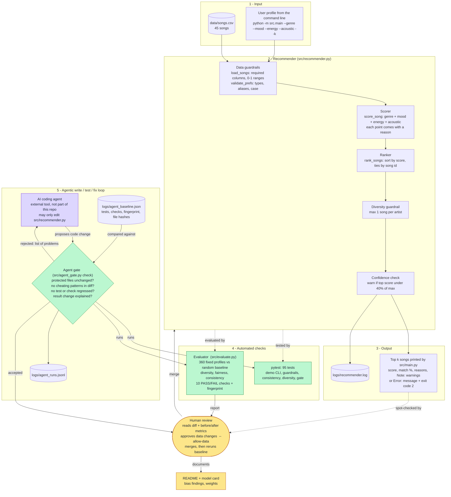

# System Diagram

How the music recommender is organized: data flows from input to recommendations (top), the evaluator and tests check the results (middle), and an AI agent's code changes must pass the gate and a human review before they are kept (bottom).

## Key

| Color | Meaning |
|---|---|
| Yellow | A human checks or decides |
| Green | Automated testing checks AI and code results |
| Purple | The AI agent that writes and fixes code (an outside tool; the repo provides the gate it must pass) |

**Where results are checked**

- **Guardrails inside the recommender** reject bad data and bad input, cap repeat artists, and flag low-confidence results.
- **pytest** checks behavior on every change. Consistency tests make sure the same question always gets the same answer.
- **The evaluator** measures genre diversity and fairness across 360 profiles. Its two current failures (metal exposure and metal fans' hit rate) are real bias findings, reported in the model card instead of hidden.
- **The agent gate** compares a change with the saved baseline. It accepts an AI-written change only if no test or check gets worse and no protected file (tests, thresholds, data) was touched.
- **A human** has the final say: they review every accepted change, approve any data change, and record findings in the model card.
